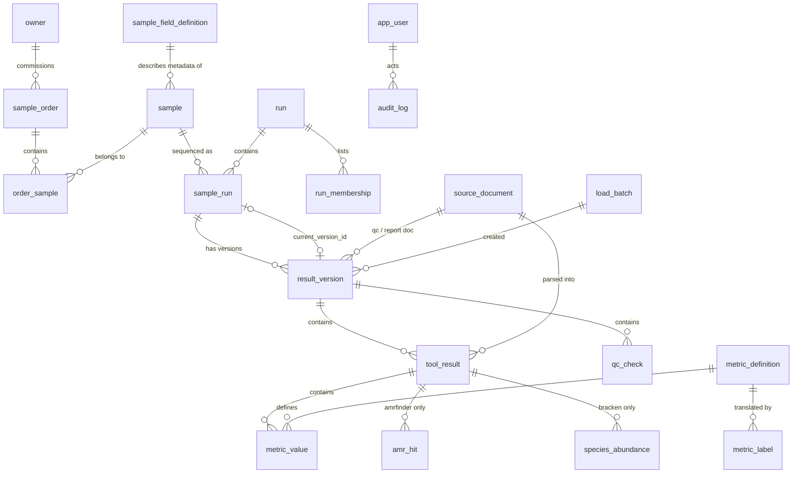

# qcdb — Stage 1 design (for approval)

Status: **DRAFT v2. Answers to the questions are recorded in §13 (2026-11-02); awaiting final
approval.** No application code has been written. This document
covers the data model, the screens, the stage plan, the design decisions I need you to approve,
and the questions from the brief. Items marked **[Q#]** or **[D#]** stay open until you answer.

The reference material from the brief is saved verbatim under `spec/`:

| File | Content |
|---|---|
| `spec/metric_dictionary.psv` | the 140-entry metric dictionary (checked: 140 lines, 6 fields each, no duplicate keys) |
| `spec/metrics.schema.json` | metrics document JSON Schema (Reference A) |
| `spec/qc.schema.json` | QC document JSON Schema (Reference C) |

---

## 1. Overview

```text
pipeline outdir ──► qcdb load (CLI / Nextflow QCDB_LOAD) ──► PostgreSQL ◄── FastAPI ◄── React (PL)
                     │ validate (schema + dictionary)                            ▲
                     │ resolve run_id, one transaction per (run_id, sample_id)   │
                     └ idempotent via SHA-256 of document bytes        nginx (TLS) ─┘
```

Repository layout (proposed):

```text
backend/            Python package `qcdb` (CLI, loader, models, Alembic, API), tests
  src/qcdb/data/    metric_dictionary.psv (versioned copy), metric_labels.pl.psv, JSON schemas
frontend/           Vite + React + TypeScript, Vitest, Playwright e2e
modules/local/qcdb_load/main.nf   Nextflow module
deploy/             docker-compose.yml, nginx, .env.example, backup/restore scripts
docs/               design, README sections, operator checklist, data-protection notes
spec/               verbatim reference copies from the brief (read-only)
```

---

## 2. Data model

### 2.1 ERD



### 2.2 DDL (draft, PostgreSQL 16)

Owner fields and sample metadata follow the answers to Q1 and Q2 (§13).

```sql
CREATE EXTENSION IF NOT EXISTS pg_trgm;   -- substring search (see §2.6)

-------------------------------------------------------------------- dictionary
CREATE TABLE metric_dictionary_import (
    id            bigint GENERATED ALWAYS AS IDENTITY PRIMARY KEY,
    file_name     text        NOT NULL,
    sha256        char(64)    NOT NULL UNIQUE,      -- re-import of same file = no-op
    n_entries     integer     NOT NULL,
    n_added       integer     NOT NULL,
    imported_at   timestamptz NOT NULL DEFAULT now(),
    imported_by   text        NOT NULL               -- OS user running the CLI
);

CREATE TABLE metric_definition (
    key            text PRIMARY KEY,                 -- '<tool>.<metric>'
    tool           text NOT NULL,
    metric         text NOT NULL,
    unit           text NOT NULL,
    value_type     text NOT NULL CHECK (value_type IN ('int','float','str','bool')),
    range_min      numeric,                          -- NULL = open bound
    range_max      numeric,
    label          text NOT NULL,                    -- English, from dictionary
    description    text NOT NULL,
    added_in_import_id bigint NOT NULL REFERENCES metric_dictionary_import(id),
    UNIQUE (tool, metric),
    CHECK (key = tool || '.' || metric)
);

CREATE TABLE metric_label (                          -- Polish (and future) labels, see D7
    metric_key  text NOT NULL REFERENCES metric_definition(key),
    lang        text NOT NULL CHECK (lang ~ '^[a-z]{2}$'),
    label       text NOT NULL,
    description text,
    PRIMARY KEY (metric_key, lang)
);

-------------------------------------------------------------------- people, orders, samples
CREATE TABLE owner (                                 -- natural person who commissioned the analysis
    id          bigint GENERATED ALWAYS AS IDENTITY PRIMARY KEY,
    full_name   text,                                -- identity: visible to all roles
    email       text,                                -- contact: hidden from viewer; optional
    created_at  timestamptz NOT NULL DEFAULT now(),
    updated_at  timestamptz NOT NULL DEFAULT now(),
    erased_at   timestamptz,                         -- pseudonymised (Q6)
    CHECK ((erased_at IS NULL) = (full_name IS NOT NULL)),   -- name required until erasure
    CHECK (erased_at IS NULL OR email IS NULL)
);

CREATE TABLE sample_order (                          -- "order" is a reserved word
    id          bigint GENERATED ALWAYS AS IDENTITY PRIMARY KEY,
    order_code  text NOT NULL UNIQUE,                -- free string, e.g. 'ZL/2026/001'
    owner_id    bigint REFERENCES owner(id),         -- exactly one owner; NULL = not yet assigned
    meta        jsonb,                               -- verbatim order.json "meta", never parsed
    created_at  timestamptz NOT NULL DEFAULT now(),
    updated_at  timestamptz NOT NULL DEFAULT now()
);

CREATE TABLE sample_field_definition (             -- admin-configurable metadata fields (Q2)
    id          bigint GENERATED ALWAYS AS IDENTITY PRIMARY KEY,
    key         text NOT NULL UNIQUE CHECK (key ~ '^[a-z][a-z0-9_]*$'),  -- immutable once created
    label       text NOT NULL,                       -- Polish label shown in the UI
    data_type   text NOT NULL CHECK (data_type IN ('text','number','date','choice')),
    choices     text[],                              -- allowed values for 'choice'
    required    boolean NOT NULL DEFAULT false,
    ordinal     integer NOT NULL,
    is_active   boolean NOT NULL DEFAULT true,       -- deactivated, never deleted
    created_at  timestamptz NOT NULL DEFAULT now(),
    CHECK ((data_type = 'choice') = (choices IS NOT NULL))
);
-- Seeded (all optional until an admin changes it): material_type "Rodzaj materiału",
-- collection_site "Źródło / miejsce pobrania", collection_date "Data pobrania" (date),
-- expected_species "Oczekiwany gatunek".

CREATE TABLE sample (                                -- biological sample with confirmed metadata
    id          bigint GENERATED ALWAYS AS IDENTITY PRIMARY KEY,
    sample_code text NOT NULL,                       -- NOT unique: unrelated samples may share 'S01' (Q9)
    metadata    jsonb NOT NULL DEFAULT '{}',         -- {field key: value}, validated by API/import
                                                     -- against sample_field_definition
    created_at  timestamptz NOT NULL DEFAULT now(),
    updated_at  timestamptz NOT NULL DEFAULT now()
);

CREATE TABLE order_sample (                          -- a sample can belong to several orders (Q4)
    order_id    bigint NOT NULL REFERENCES sample_order(id),
    sample_id   bigint NOT NULL REFERENCES sample(id),
    source      text   NOT NULL CHECK (source IN ('ui','order_json','metadata')),
    linked_at   timestamptz NOT NULL DEFAULT now(),
    PRIMARY KEY (order_id, sample_id)
);

-------------------------------------------------------------------- loads and raw documents
CREATE TABLE load_batch (                            -- created lazily: only if something is written
    id           bigint GENERATED ALWAYS AS IDENTITY PRIMARY KEY,
    started_at   timestamptz NOT NULL,
    finished_at  timestamptz,
    invoked_by   text NOT NULL,                      -- OS user / 'nextflow:<task hash>'
    qcdb_version text NOT NULL,
    source_dir   text NOT NULL,                      -- technical
    options      jsonb NOT NULL,                     -- --run-id, --run-date, file names; no secrets
    counts       jsonb
);

CREATE TABLE source_document (                       -- content-addressed copy of every JSON loaded
    id             bigint GENERATED ALWAYS AS IDENTITY PRIMARY KEY,
    sha256         char(64) NOT NULL UNIQUE,         -- of the original file bytes
    kind           text NOT NULL CHECK (kind IN ('metrics','qc','report','run','order')),
    schema_version text NOT NULL,
    file_name      text NOT NULL,                    -- basename when first seen (technical)
    size_bytes     integer NOT NULL,
    content        jsonb NOT NULL,                   -- numbers kept exact (jsonb numeric)
    first_batch_id bigint NOT NULL REFERENCES load_batch(id)
);

-------------------------------------------------------------------- runs and results
CREATE TABLE run (
    id              bigint GENERATED ALWAYS AS IDENTITY PRIMARY KEY,
    run_code        text NOT NULL UNIQUE,            -- run_id from the documents
    run_date        date,                            -- only from --run-date / metadata / UI
    run_date_source text CHECK (run_date_source IN ('cli','metadata','ui')),
    run_document_id bigint REFERENCES source_document(id), -- latest run.json, if any
    created_at      timestamptz NOT NULL DEFAULT now(),
    CHECK ((run_date IS NULL) = (run_date_source IS NULL))
);

CREATE TABLE run_membership (                        -- who says sample X belongs to run R
    run_id        bigint NOT NULL REFERENCES run(id),
    sample_code   text   NOT NULL,
    source        text   NOT NULL CHECK (source IN ('report','run_json','samplesheet','cli')),
    source_sha256 char(64) NOT NULL,                 -- file that asserted it (samplesheet: hash only)
    run_json_entry jsonb,                            -- verbatim samples[] item when source='run_json'
    PRIMARY KEY (run_id, sample_code, source)
);

CREATE TABLE sample_run (                            -- result key (run_id, sample_id)
    id                 bigint GENERATED ALWAYS AS IDENTITY PRIMARY KEY,
    run_id             bigint NOT NULL REFERENCES run(id),
    sample_code        text   NOT NULL,              -- sample_id exactly as in the documents
    sample_id          bigint REFERENCES sample(id), -- auto-linked by sample_code, correctable in UI
    current_version_id bigint,                       -- FK below; NULL = known sample, no results
    created_at         timestamptz NOT NULL DEFAULT now(),
    UNIQUE (run_id, sample_code)
);

CREATE TABLE result_version (                        -- immutable snapshot of one load of a key
    id               bigint GENERATED ALWAYS AS IDENTITY PRIMARY KEY,
    sample_run_id    bigint  NOT NULL REFERENCES sample_run(id),
    version_no       integer NOT NULL,
    load_batch_id    bigint  NOT NULL REFERENCES load_batch(id),
    fingerprint      char(64) NOT NULL,              -- sha256 of sorted "kind:tool:sha256" lines
    created_at       timestamptz NOT NULL DEFAULT now(),
    has_qc           boolean NOT NULL,
    has_report       boolean NOT NULL,
    -- from <sample>.qc.json (all NULL when has_qc = false)
    qc_document_id      bigint REFERENCES source_document(id),
    verdict             text CHECK (verdict IN ('PASS','WARN','FAIL')),
    evaluator_version   text,
    thresholds_file     text,                        -- technical
    thresholds_sha256   char(64),
    profile             text,                        -- free string, no enum (trap 14)
    read_length_profile text,
    threshold_species   text,
    threshold_chain     text[],
    expected_taxid      integer,
    context_read_length numeric,
    depth_basis         text,
    reasons             text[],
    advisory            text[],
    notes               text[],
    unused_inputs       text[],
    qc_inputs           jsonb,                       -- inputs[] verbatim (paths: technical)
    -- from <sample>.report.json (all NULL when has_report = false)
    report_document_id  bigint REFERENCES source_document(id),
    report_run_id       text,
    meta                jsonb,                       -- verbatim, never parsed into owners (trap 12)
    report_generator_version text,
    pipeline            text,
    pipeline_version    text,
    nextflow_version    text,
    software            jsonb,                       -- groups[] / other[] verbatim
    typing_species      jsonb,                       -- typing.species verbatim
    load_warnings       text[] NOT NULL DEFAULT '{}',-- e.g. qc inputs sha256 mismatch
    UNIQUE (sample_run_id, version_no),
    UNIQUE (sample_run_id, fingerprint),
    CHECK (has_qc = (qc_document_id IS NOT NULL)),
    CHECK (has_qc = (verdict IS NOT NULL)),
    CHECK (has_report = (report_document_id IS NOT NULL))
);

ALTER TABLE sample_run ADD CONSTRAINT sample_run_current_fk
    FOREIGN KEY (current_version_id) REFERENCES result_version(id)
    DEFERRABLE INITIALLY DEFERRED;
-- plus a trigger asserting current_version.sample_run_id = sample_run.id

CREATE TABLE tool_result (                           -- one <sample>.<tool>.metrics.json
    id               bigint GENERATED ALWAYS AS IDENTITY PRIMARY KEY,
    version_id       bigint NOT NULL REFERENCES result_version(id) ON DELETE CASCADE,
    document_id      bigint NOT NULL REFERENCES source_document(id),
    tool             text NOT NULL,
    namespace        text NOT NULL CHECK (namespace IN
                       ('input','demux','reads','composition','species','assembly','characterisation')),
    status           text NOT NULL CHECK (status IN ('ok','empty','skipped','failed','missing')),
    messages         text[],                         -- NULL = key absent, '{}' = empty list
    tool_version     text NOT NULL,
    database_version text,
    parser_name      text NOT NULL,
    parser_version   text NOT NULL,
    schema_version   text NOT NULL,
    inputs           jsonb,                          -- technical (paths)
    data             jsonb,                          -- NULL = key absent
    UNIQUE (version_id, tool)
);

CREATE TABLE metric_value (                          -- long format; absent metric = no row
    id             bigint GENERATED ALWAYS AS IDENTITY PRIMARY KEY,
    tool_result_id bigint NOT NULL REFERENCES tool_result(id) ON DELETE CASCADE,
    metric_key     text   NOT NULL REFERENCES metric_definition(key),
    unit           text   NOT NULL,
    value_num      numeric,                          -- exact decimal, no float rounding
    value_text     text,
    value_bool     boolean,
    CHECK (num_nonnulls(value_num, value_text, value_bool) <= 1),  -- all NULL = JSON null
    UNIQUE (tool_result_id, metric_key)
);
-- No CHECK on percentage ranges (trap 6): ranges are enforced by the loader from the dictionary.

CREATE TABLE qc_check (                              -- one row per checks[] item, in order
    id         bigint GENERATED ALWAYS AS IDENTITY PRIMARY KEY,
    version_id bigint   NOT NULL REFERENCES result_version(id) ON DELETE CASCADE,
    ordinal    smallint NOT NULL,
    metric     text     NOT NULL,                    -- NO FK to metric_definition (trap 8)
    value_num  numeric,
    value_text text,
    unit       text,
    rule       jsonb    NOT NULL,                    -- {"min":80,"warn_min":85} verbatim
    required   boolean  NOT NULL,
    status     text     NOT NULL CHECK (status IN ('PASS','WARN','FAIL','NA')),
    reason     text,
    CHECK (num_nonnulls(value_num, value_text) <= 1),
    CHECK ((status = 'PASS') = (reason IS NULL)),
    CHECK (status <> 'NA' OR (NOT required AND value_num IS NULL AND value_text IS NULL)),
    UNIQUE (version_id, ordinal)
);

CREATE TABLE amr_hit (                               -- from amrfinder data.hits[]
    id             bigint GENERATED ALWAYS AS IDENTITY PRIMARY KEY,
    tool_result_id bigint NOT NULL REFERENCES tool_result(id) ON DELETE CASCADE,
    ordinal        integer NOT NULL,
    symbol text, name text, type text, subtype text, class text, subclass text, method text,
    pct_identity numeric, pct_coverage numeric, scope text, contig text,
    start_pos bigint, stop_pos bigint, strand text, accession text,
    UNIQUE (tool_result_id, ordinal)
);   -- all columns nullable: fields may be absent; tool_result.data stays the full copy

CREATE TABLE species_abundance (                     -- from bracken data.abundances[]
    id             bigint GENERATED ALWAYS AS IDENTITY PRIMARY KEY,
    tool_result_id bigint NOT NULL REFERENCES tool_result(id) ON DELETE CASCADE,
    ordinal        integer NOT NULL,
    name text, taxid integer, reads bigint, pct numeric,
    UNIQUE (tool_result_id, ordinal)
);

-------------------------------------------------------------------- users, sessions, audit
CREATE TABLE app_user (
    id              bigint GENERATED ALWAYS AS IDENTITY PRIMARY KEY,
    username        text NOT NULL UNIQUE,
    password_hash   text NOT NULL,                   -- argon2id (argon2-cffi)
    role            text NOT NULL CHECK (role IN ('admin','bioinformatician','viewer')),
    is_active       boolean NOT NULL DEFAULT true,
    failed_logins   integer NOT NULL DEFAULT 0,      -- login throttling
    locked_until    timestamptz,
    created_at      timestamptz NOT NULL DEFAULT now(),
    last_login_at   timestamptz
);

CREATE TABLE user_session (                          -- server-side sessions (revocable)
    token_hash   char(64) PRIMARY KEY,               -- sha256 of the random cookie value
    user_id      bigint NOT NULL REFERENCES app_user(id) ON DELETE CASCADE,
    csrf_token   text NOT NULL,
    created_at   timestamptz NOT NULL DEFAULT now(),
    last_seen_at timestamptz NOT NULL DEFAULT now(),
    expires_at   timestamptz NOT NULL
);

CREATE TABLE audit_log (                             -- append-only (app roles: INSERT only)
    id            bigint GENERATED ALWAYS AS IDENTITY PRIMARY KEY,
    occurred_at   timestamptz NOT NULL DEFAULT now(),
    actor_user_id bigint REFERENCES app_user(id),
    actor_label   text NOT NULL,                     -- username snapshot or 'loader:<os user>'
    load_batch_id bigint REFERENCES load_batch(id),
    action        text NOT NULL,                     -- create|update|delete|link|unlink|set_current|load|erase
    entity_type   text NOT NULL,
    entity_id     bigint NOT NULL,
    changes       jsonb NOT NULL                     -- {"field":{"old":..,"new":..}}; personal fields: "changed" only
);
```

### 2.3 How each data trap is handled

| # | Trap | Design answer |
|---|---|---|
| 1 | No run_id/dates in metrics/qc | Resolver collects run_id from all available sources (report.json → run.json membership → samplesheet → `--run-id`). Absent/`null` sources are ignored; **any disagreement between present sources rejects the sample**, naming each source and value; no source rejects it too. `run_date` only from `--run-date`, the metadata import or the UI. No parsing of IDs. |
| 2 | Result key | `sample_run UNIQUE (run_id, sample_code)`; the same `sample_code` in two runs = two rows. |
| 3 | absent ≠ null ≠ 0 | absent → no `metric_value` row; `null` → row with all three value columns NULL (loader requires non-empty `messages`); `0` → `value_num = 0`. Same for `messages`/`data` (NULL column = key absent). |
| 4 | Mixed types | Three typed value columns + `CHECK num_nonnulls <= 1`; `mlst.sequence_type` goes to `value_text`. |
| 5 | Pairs vs reads | `metric_value` keeps dictionary units (`pairs`). Summary columns `raw_reads`/`reads` are explicitly `× 2` in the view and carry unit `reads`. Trends chart one metric in its own unit only. `run.json` `scale` is stored with the column metadata as a display hint only. |
| 6 | % > 100 | No DB CHECK on ranges; the loader enforces dictionary ranges (`checkm*.pct_contamination` is `0..`). |
| 7 | Verdict vs thresholds | `result_version` stores verdict, sha256, file, profile, read_length_profile, species, chain, context; `qc_check` stores every check with `rule` verbatim. Nothing is recomputed. |
| 8 | Check metrics | `qc_check.metric` is plain text, no FK. |
| 9 | Tool statuses | All five stored; `empty` displayed as neutral (not error). Schema `allOf` rules enforced by the loader. |
| 10 | Names in `data` | Never used for joining; the only join key is `sample_id` from the document. |
| 11 | Paths | Stored (`inputs`, `data`, `source_document.file_name`, `thresholds_file`, `qc_inputs`, `load_batch.source_dir`), returned only to `admin`/`bioinformatician` (§5). |
| 12 | Free-form `meta` | `result_version.meta` / `sample_order.meta` JSONB verbatim; never creates owners; hidden from `viewer` (may name a person). |
| 13 | `report: false` | `run_membership` row + `sample_run` with `current_version_id = NULL` (shown as "brak wyników"), or a version with `verdict = NULL` if some documents exist. `ectyper.qc` is an ordinary `metric_value` labelled as a tool flag. |
| 14 | Profiles | `profile text`, no enum. |
| 15 | Floats | JSON parsed with `Decimal`; stored as `numeric` (exact). Tests compare by value (`Decimal("151") == Decimal("151.0")`). |

### 2.4 Reprocessing and versions (for approval: D1, Q5)

* A **result version** is an immutable snapshot of the documents found for one
  `(run_id, sample_id)` in one load. Its `fingerprint` is the SHA-256 of the sorted list of
  `kind:tool:sha256` of those documents.
* Same fingerprint as **any** existing version of the key → nothing is written (idempotent; this also
  covers re-loading an older directory, which does not change the current version).
* Different fingerprint → new version `version_no + 1`. Old versions and their verdicts are never
  updated or deleted. The audit log records `load` with the old and new verdict.
* **Which version is current** is your call [Q5]. The mechanism supports both:
  (a) newest becomes current automatically, or (b) first version is current automatically, later
  ones wait until a bioinformatician selects one (`set_current`, audited).
* **D1:** a load is treated as the **complete** set of documents for the key (a version contains only
  what was on disk). If a new version lacks tools present in the current one, the loader prints a
  warning. The alternative, merging with the previous version, makes versions harder to reason
  about. I recommend "complete set".

### 2.5 Sample table: materialized view (D2)

`sample_run_summary` is a **materialized view**: one row per `sample_run`, built from the current
version only. It holds the verdict, completeness flags, profile, `thresholds_sha256`, species, MLST ST,
serotype, `n_amr_genes` and the 16 run-document columns. Owner/order/sample metadata are **not** in
the view; the API joins them live, so a UI edit shows up immediately.

Why materialized and not a plain view:

* The 16 columns are a pivot over `metric_value` (≈250 rows per result). A plain view must pivot every
  current result before it can sort or paginate on any column. The MV is pivoted once, and its
  columns get ordinary B-tree indexes.
* The underlying data changes only on load or `set_current` (a few times a day). After committing,
  the loader runs `REFRESH MATERIALIZED VIEW CONCURRENTLY`, and so does the `set_current` endpoint.
  Readers are never blocked (this needs the unique index on `sample_run_id`).
* Consistency: if a refresh fails, the base tables are still correct. Re-running the same load
  (a no-op for data) refreshes again.
* If your answer to Q7 is "a few thousand samples in total", a plain view would also be fast enough. The
  API reads the same column names either way, so we can switch with one migration.

Column mapping (**D3, please confirm**; ✔ = matches the numbers in the brief's example, ? = my inference):

| Column | Source | |
|---|---|---|
| raw_reads | `fastp.read_pairs_before_filter` × 2 | ✔ 1428832×2 = 2857664 |
| raw_bases | `fastp.bases_before_filter` | ✔ |
| raw_q30 | `fastp.pct_q30_before_filter` | ✔ |
| raw_read_length | `fastp.read_length` | ✔ |
| reads | `fastp.read_pairs_after_filter` × 2 | ✔ |
| bases | `fastp.bases_after_filter` | ✔ |
| q30 | `fastp.pct_q30_after_filter` | ✔ |
| trimmed_read_length | `fastp.mean_read_length_after_filter` | ✔ |
| pct_reads_passed | `fastp.pct_reads_passed_filter` | ✔ |
| n_contigs | `seqkit.n_contigs` (alt. `quast.n_contigs`) | ? |
| assembly_length | `seqkit.total_length` (alt. `quast.total_length`) | ? bases/len = 74.9057 = example depth |
| n50 | `seqkit.n50` (alt. `quast.n50`) | ? |
| gc | `quast.pct_gc` (alt. `seqkit.pct_gc`) | ? |
| depth | `qc_check` value of `derived.depth` (computed by qceval, displayed, not recomputed) | ? |
| completeness / contamination | `checkm2.*` (alt. `checkm.*`) | ? |
| species | report.json `typing.species.name` when `available` (alt. `bracken.top_species`) | ? |
| mlst_st | `mlst.sequence_type` | |
| serotype | `seqsero2.serotype`, else `ectyper.serotype` | ? |
| n_amr_genes | `amrfinder.n_amr_genes` | |

When `run.json` is present, the loader compares its `values` with the mapped values and reports any
difference as a warning. This is how the mapping gets verified against real runs (see the checklist
in §8).

### 2.6 Indexes and why

| Index | Serves |
|---|---|
| `sample_run (run_id, sample_code)` unique | result key lookup during load; Run screen |
| `sample_run (sample_id)`, `order_sample (sample_id)`, `sample_order (owner_id)`, `sample (sample_code)` | owner/order filters, auto-linking, Owners & orders screen |
| GIN on `sample.metadata` | filtering by configurable metadata fields |
| `result_version (sample_run_id, version_no)` unique | history list |
| `tool_result (version_id, tool)` unique | sample detail, per-tool lookup |
| `metric_value (metric_key, tool_result_id) INCLUDE (value_num)` | **trends**: one metric across all results, index-only scan |
| `metric_value (tool_result_id, metric_key)` unique | sample detail, idempotency |
| `qc_check (version_id, ordinal)` unique | detail; `(metric)` for the check-metric trend (`derived.depth`) |
| `amr_hit (symbol)`, `amr_hit (class)`, `species_abundance (name, pct)` | the AMR/species filters, if confirmed (Q11) |
| `source_document (sha256)` unique | idempotency check before parsing |
| MV: unique `(sample_run_id)`; `(run_id)`, `(run_date)`, `(verdict)`, `(species)`, `(thresholds_sha256)`, `(profile)` | sample-table filters, refresh CONCURRENTLY, trend change markers |
| GIN trigram on `sample_run.sample_code`, `run.run_code`, `sample_order.order_code` | the search box (substring match, e.g. `5156`) |
| `audit_log (entity_type, entity_id, occurred_at)` | history of one entity |

I am deliberately not indexing every summary metric column: at lab scale a sort over the MV
fits in memory. I'll add an index only if a measured query needs one.

### 2.7 Database roles (defence in depth)

`qcdb_owner` (migrations/DDL), `qcdb_app` (API: DML, INSERT-only on `audit_log`), `qcdb_loader`
(result tables, `run`, `sample` link, dictionary; **no** access to `owner`). Credentials come from
env vars / Docker / Nextflow secrets only.

---

## 3. Loader

```text
qcdb load <directory> [--run-id ID] [--run-date YYYY-MM-DD] [--metadata FILE] [--dry-run]
qcdb import-dictionary <file>
```

1. **Scan** the directory recursively and follow symlinks (Nextflow staging). Recognise
   `*.metrics.json`, `*.qc.json`, `*.report.json`, `*.run.json`, `*.order.json`, and samplesheets
   by name [Q12]. `*.run.tsv`/`*.order.tsv` are ignored (run.json preferred). Everything else is
   ignored and counted.
2. **Read**: strict UTF-8 JSON with `Decimal` numbers and duplicate-key detection. If a file
   cannot be read → it is counted as unreadable (exit 3).
3. **Version gate**: `schema_version` major must be `1`; otherwise reject with
   `unsupported schema_version "2.0" (supported: 1.x)`.
4. **Validate**
   * metrics: stage 1 JSON Schema (`spec/metrics.schema.json`, Draft 2020-12), then stage 2
     dictionary checks exactly as in the brief. An unknown key fails with
     `… not in metric dictionary; update it with "qcdb import-dictionary <file>"`. Interpretation
     to confirm (D4): `int` follows the JSON token, so `151.0` is **not** an int, matching a Python
     `isinstance(v, int)` check. A known tool with a different namespace than the table in the brief →
     error; an unknown tool → accepted if its metrics are in the dictionary.
   * qc: `spec/qc.schema.json`.
   * report/run/order: only the fields we read, checked against the outlines.
   * file name vs content (`<sample_id>.<tool>.metrics.json`): mismatch → warning; content wins.
5. **Group** by `sample_id`. Two *different* documents for the same `(sample_id, tool)` in one load →
   reject that sample ("load run directories separately"). Byte-identical duplicates are de-duplicated.
6. **Resolve run_id** (§2.3, trap 1). `--run-date` with more than one run in the load → usage
   error (exit 2). If the run already has a different date → error; dates are changed in the UI.
7. **One transaction per `(run_id, sample_id)`**: version check → insert documents, version,
   tool results, metrics, checks, child rows → set current per Q5 → audit. Any error rolls back
   the whole sample and is printed as `REJECT <file>: <problem>`. Other samples continue.
8. **Warnings**: `qc.json inputs[].sha256` vs loaded metrics files (mismatch, input not loaded);
   run.json `verdict`/`summary`/`values` vs DB; file-name mismatches. Warnings are stored in
   `result_version.load_warnings`.
9. run.json → `run` + `run_membership`; samples with `report: false` and no documents get a
   `sample_run` without a version. order.json → creates the `sample_order` if missing (**no owner**),
   stores `meta`, links samples by `(run_id, sample_id)`. If a sample is already linked to a
   different order, it is reported and not overwritten (D5).
10. `--metadata FILE`: format depends on Q3. `--dry-run`: everything runs inside transactions that
    are rolled back, and the same counts are printed.
11. `load_batch` is inserted only when something is written, so a repeated identical load changes
    **no rows at all**.
12. Output: per kind, loaded / skipped (identical) / rejected; samples: new / unchanged / rejected
    / incomplete; warnings. **Exit codes:** `2` usage error (nothing loaded); else `3` if any file
    was unreadable; else `1` if any document/sample was rejected; else `0`. Warnings do not change
    the exit code (D6).
13. Credentials: `QCDB_DATABASE_URL` or `PG*` env vars, `QCDB_DATABASE_PASSWORD_FILE` for secrets.
    No password arguments. The DSN is printed with the password masked.

`import-dictionary`: adds new keys. If an existing key changes its unit, type or range, the import is
rejected (contract: never redefined). A changed label or description is accepted and audited. A key
missing from the new file is rejected. Re-importing the same file is a no-op. The packaged
`metric_dictionary.psv` is imported by the `migrate` step of the deployment.

### Nextflow module (sketch)

```groovy
process QCDB_LOAD {
    tag "${run_id}"
    label 'process_single'
    container 'qcdb:1.0.0'
    secret 'QCDB_DATABASE_URL'                     // nextflow secrets set QCDB_DATABASE_URL ...

    input:
    tuple val(run_id), path(docs, stageAs: 'qcdb_in/*')
    path samplesheet, stageAs: 'qcdb_in/samplesheet.csv'

    output:
    path "qcdb_load.log", emit: log
    path "versions.yml",  emit: versions

    when:
    task.ext.when == null || task.ext.when

    script:
    def args = task.ext.args ?: ''                 // e.g. "--run-date 2026-06-30"
    """
    qcdb load qcdb_in --run-id '${run_id}' ${args} 2>&1 | tee qcdb_load.log
    # pipefail: a failed load fails the task; inputs are only read, never written
    ...versions.yml as in RUN_REPORT...
    """
}
// Grouping per run:
// ch_docs = QC_EVAL.out.json.mix(METRICS.out.json, SAMPLE_REPORT.out.json)
//               .map { meta, json -> [ meta.run_id, json ] }.groupTuple()
//               .join(RUN_REPORT.out.json).map { run_id, docs, run_json -> [ run_id, docs + [run_json] ] }
// To keep the pipeline going on load failure: withName: QCDB_LOAD { errorStrategy = 'ignore' }
```

---

## 4. API (FastAPI, `/api/v1`)

OpenAPI is generated from Pydantic models and served at `/api/v1/openapi.json`. A CI test fails if the
committed `openapi.json` is stale. Every list endpoint has `page`, `page_size` (≤ 500) and
`sort=<field>[,-field]` with a whitelist of fields.

| Area | Endpoints |
|---|---|
| Auth | `POST /auth/login`, `POST /auth/logout`, `GET /auth/me` (role + CSRF token) |
| Results | `GET /results` (filters: run, owner, order, species, verdict incl. `none`, date_from/to, `q`), `GET /results/export.csv`, `GET /results/{id}`, `GET /results/{id}/versions`, `GET /results/{id}/versions/{no}`, `POST /results/{id}/current` |
| Runs | `GET /runs`, `GET /runs/{run_code}` (summary + run.json summary comparison), `GET /runs/{run_code}/outliers`, `PATCH /runs/{run_code}` (run_date) |
| Metrics | `GET /metrics` (definitions + labels), `GET /trends?metric=…&group_by=species|run|profile&…` (points, distribution, threshold-sha change markers) |
| Owners/orders/samples | CRUD `GET/POST/PATCH/DELETE /owners`, `/orders`, `/samples`; `POST /orders/{id}/samples` (assign), `DELETE /orders/{id}/samples/{sid}`; `POST /owners/{id}/erase` [Q6] |
| Users (admin) | `GET/POST/PATCH /users`, `POST /users/{id}/password` (deactivate, no hard delete) |
| Audit (admin) | `GET /audit?entity_type=&entity_id=` |
| Health | `GET /health` (liveness), `GET /health/ready` (DB + migrations at head) |

Auth: an opaque random session cookie (`HttpOnly; Secure; SameSite=Strict`), server-side session
rows, 8 h idle timeout. CSRF uses a double-submit token in an `X-CSRF-Token` header on every unsafe
method. Repeated failed logins are throttled. Only SQLAlchemy parameterised queries are used. Logs contain
request ids, user ids and paths, never bodies, names or contact data. CSV cells starting with
`= + - @` are escaped against formula injection.

---

## 5. Roles

| Capability | viewer | bioinformatician | admin |
|---|:-:|:-:|:-:|
| Samples, detail, run, trends (results, checks, metrics, typing, AMR) | ✔ | ✔ | ✔ |
| Owner identity fields / contact fields [Q1] | ✔ / ✗ | ✔ / ✔ | ✔ / ✔ |
| Technical data: `inputs`, raw `data`, file names, `thresholds.file`, `qc_inputs`, load info, raw `meta` | ✗ | ✔ | ✔ |
| Tool `messages` | paths masked to basename (D8) | full | full |
| `sylph.taxonomies_used` value (may be a path) | ✗ | ✔ | ✔ |
| CSV export | ✔ (same field rules) | ✔ | ✔ |
| Edit owners/orders/sample metadata, assign samples, run date, set current version | ✗ | ✔ | ✔ |
| Erase owner personal data | ✗ | ✗ | ✔ |
| Users, audit log | ✗ | ✗ | ✔ |

The API serialises with a separate response model per role (fields are omitted, not set to null).
A role-matrix test calls every endpoint as every role.

---

## 6. Screens (Polish UI, no external CDN: all JS, CSS and fonts are bundled; system font stack)

Stack: Vite, React, TypeScript, React Router, TanStack Query + Table, Apache ECharts (bundled,
tree-shaken; has a native box plot). Filters live in the URL, so a view can be shared and its CSV
export matches it.

Verdict badges always show colour **and** text: `PASS – zaliczona` (green), `WARN – ostrzeżenie`
(amber), `FAIL – niezaliczona` (red), `brak wyniku` (grey, dashed). Tool statuses: `ok` → „OK”,
`empty` → „brak wyników narzędzia” (neutral), `skipped` → „pominięto”, `failed` → „błąd”,
`missing` → „brak dokumentu”. Check `NA` → „brak danych (nie wpływa na werdykt)”. Stages:
reads „Odczyty”, composition „Skład taksonomiczny”, assembly „Składanie genomu”,
characterisation „Charakterystyka”, input „Dane wejściowe”, demux „Demultipleksacja”,
species „Gatunek”. Stored values stay exactly as documented (D9: please check the wording).

0. **Logowanie**: username + password.
1. **Próbki**: filters: przebieg, zleceniodawca, zlecenie, gatunek, werdykt (incl. „brak wyniku”),
   data przebiegu od–do, search (sample_id / run / order), [Q11] AMR gene / class, species in the
   composition. Server-side paginated table (sample_id, run, date, order, owner, verdict, profile,
   species, ST, serotype, AMR count, the 16 columns with units from metadata and `×2` reads),
   „niekompletne” markers, `Eksport CSV`. Runs without a date are excluded when a date filter is set,
   and the screen says how many.
2. **Szczegóły próbki** (`/wyniki/{id}`)
   * header: sample_id, run, run date, order/owner, verdict badge, profile, read_length_profile,
     threshold species, chain, `thresholds.sha256` (short + copy), evaluator version,
     completeness flags.
   * **Kontrola jakości**: checks table (metric label or raw name, value, unit, rule rendered
     as `min 80 · warn_min 85`, required, status, reason) + reasons / advisory / notes.
   * **Metryki wg etapu**: namespace → tool card (status, version, database version, parser,
     messages, metrics with PL label + unit). `null` is shown as „brak wartości” with the messages.
     A toggle „pokaż nieobecne” lists dictionary metrics with no row as „nieobecna”. All three
     cases look different.
   * **Typowanie**: MLST (scheme, ST, allele counts, alleles from `data`), SeqSero2 / ECTyper
     serotype and antigens; `ectyper.qc` is labelled „flaga narzędzia ECTyper (nie werdykt QC)”.
   * **AMR**: amr_hit table filterable by type / class.
   * **Skład gatunkowy**: Bracken abundances.
   * **Oprogramowanie**: pipeline, versions, per-stage tools/databases from report `software`
     plus tool/db/parser versions from metrics documents.
   * **Historia przetwarzania**: versions (no., load time, verdict, sha256, profile, current
     marker), diff of verdict and checks against the previous version, „ustaw jako bieżącą”
     (bioinformatician).
   * **Metadane próbki** (edit form, fields per Q2); **Dane techniczne** (bioinformatician+:
     inputs, raw `data`, `meta`, files + hashes, load warnings).
3. **Przebieg** (`/przebiegi/{run}`): run date (editable), tiles PASS / WARN / FAIL / brak wyniku,
   compared with the run.json `summary` if loaded; the same sample table filtered to the run;
   **Wartości odstające**: per summary column, values outside the Tukey fences
   (Q1 − 1.5·IQR, Q3 + 1.5·IQR) within the run, only when n ≥ 5. It is labelled as a statistical
   hint, not a QC verdict (D10).
4. **Trendy**: metric picker (numeric metrics from `metric_definition` + check metrics such as
   `derived.depth`), date range, species / profile / run filters, „grupuj wg” gatunek / przebieg /
   profil. (a) Scatter over `run_date` in the metric's unit, coloured by verdict, with vertical
   dashed markers where `thresholds.sha256` changes, labelled with old → new short hashes;
   (b) box plot per group. Current versions only; results without a run date are counted and left
   out.
5. **Zleceniodawcy i zlecenia**: owner list / form (fields per Q1, contact fields only for
   bioinformatician+); order list / form (owner assignment); order detail with its samples and
   „przypisz próbki” (search by sample_id/run, multi-select).
6. **Użytkownicy** (admin): list, create, role, deactivate, reset password. This is needed for
   the admin role in the brief; it adds no new capability.

New metrics appear without frontend changes because every label, unit, type and grouping comes from
`/metrics`.

---

## 7. Stage plan and acceptance

| Stage | Deliverables | Evidence shown to you |
|---|---|---|
| 1 Design | this document, answers to questions | — |
| 2 DB + loader | models, Alembic migration, dictionary seed, loader CLI, Nextflow module, fixtures (1 run: PASS, WARN, FAIL, `report:false`; plus a second run sharing a sample_id; all 5 statuses; conditional metrics; `null`; contamination > 100; invalid docs) | pytest output: clean load, second load = zero row changes (table snapshots), every input metric compared by value with the DB, invalid doc → no partial rows, exit codes; ruff + mypy strict |
| 3 API + auth | FastAPI app, sessions, CSRF, role models, CSV export | pytest integration tests on real PostgreSQL, role matrix for every endpoint, viewer gets no contact fields or paths |
| 4 Dashboard | React app | Vitest + Playwright: filtering, detail verdict equals qc.json, owner assignment, metric trend; screenshots |
| 5 Deployment | compose, nginx TLS, `.env.example`, healthchecks, migrate service, backup/restore scripts, README, operator checklist | `docker compose up` from clean, fixtures loaded, login per README, restore test, all linters/tests |

Environment note: this sandbox has PostgreSQL 16 binaries but no running Docker daemon. Tests will
use `QCDB_TEST_DATABASE_URL` when it is set (a local PG16 here) and testcontainers otherwise. I will
try to start a Docker daemon for stages 3 and 5. If I can't, I will say so, and I will not claim those
steps were done. Compose pins `postgres:16` so the tested and deployed major versions match.

All verification uses fixtures I build from the brief. §8 will grow into the checklist for real
run directories.

## 8. Checklist seed for validation against real run directories

* `qcdb load --dry-run` on 3+ historical run dirs: zero rejections, or every rejection understood.
* Unknown dictionary keys found → update the dictionary, never relax validation.
* run.json-vs-DB warnings = 0 (confirms the D3 column mapping, the `×2` conversion and depth).
* `qc.json inputs[].sha256` mismatch warnings = 0 for untouched directories.
* Same dir loaded twice → second run reports 0 new, all unchanged.
* A re-processed sample → new version, old verdict still visible in history.
* Spot check 5 samples: detail verdict/checks equal `qc.json`; metrics equal `metrics.json`.
* Samples whose sample_id appears in several runs → separate rows (and Q9 behaviour).
* Tools with `empty`/`skipped`/`failed`/`missing` statuses display as expected.

## 9. Data protection: decisions for the data controller (not a compliance claim)

The system gives you the means (minimal fields, role-based visibility, audit, erasure); it does not by
itself make processing lawful. The controller (the lab's organisation, with its DPO) must decide
and document:

* the legal basis for processing owner data and its purpose (Q1);
* retention periods for owner data, results, raw documents, audit log, and **backups** (erased data
  stays in backups until they rotate out);
* the erasure procedure (Q6). Proposal: erasing an owner clears the personal fields, sets
  `erased_at`, and keeps orders/samples/results linked to a pseudonymous `Zleceniodawca #id`.
  The audit log never stores personal values, so it needs no scrubbing;
* how to treat free-form `meta` in report/order documents, which may contain a person's name. It is
  stored verbatim inside raw documents and hidden from viewers. Removing it would change the stored
  documents, so the controller has to decide whether that is required;
* who gets accounts and which role; access review; the record of processing activities; any
  DPIA (probably not needed for non-patient microbiology, but that is the controller's call);
* staff usernames in the audit log are employee personal data.

## 10. Proposals outside the brief (not planned unless you approve)

1. Audit-log screen for admins (the API exists; no UI).
2. Overlaying check thresholds (`rule` min/warn_min) on the trend chart, per threshold version.
3. `qcdb refresh-views` maintenance command (re-running a load already refreshes).
4. Login/logout events in the audit log.
5. Filtering the sample table by individual QC check status (e.g. "all WARN on `seqkit.n_contigs`").

---

## 11. Decisions for your approval

| # | Decision | My recommendation |
|---|---|---|
| D1 | A new version = the complete set of documents in that load (no merging) | yes |
| D2 | Sample table as a materialized view refreshed after load / set-current | yes (plain view if Q7 is small) |
| D3 | Summary column → metric mapping (§2.5), cross-checked against run.json | confirm the `?` rows |
| D4 | `int` metrics: `151.0` in JSON is not an integer | yes |
| D5 | order.json creates missing orders (without owner) and links samples; it never re-links a sample already in another order | yes |
| D6 | Exit-code precedence 2 > 3 > 1 > 0; warnings never change it | yes |
| D7 | **Polish labels**: a versioned overlay file `metric_labels.pl.psv` (`key\|label\|description`) in the qcdb repo, loaded into `metric_label` by `qcdb import-dictionary --labels pl <file>` (an extra option on the agreed command). Missing translations fall back to the English label, so a new metric still appears. Keys are never renamed. I'll draft PL labels for all 140 entries for your review. Alternative: admins edit labels in the UI. | overlay file |
| D8 | Viewer sees tool `messages` with absolute paths masked to the basename (a heuristic), or messages hidden entirely | mask |
| D9 | Polish wording of verdicts / statuses / stages (§6) | please correct |
| D10 | Outliers = Tukey fences within the run, n ≥ 5, labelled as a hint | yes |
| D11 | Login throttling and the `qcdb create-user` bootstrap command (password from a prompt/stdin, never an argument), needed to follow the README | yes |
| D12 | PostgreSQL 16; Python libs: SQLAlchemy 2, Alembic, psycopg 3, FastAPI, Pydantic 2, jsonschema, argon2-cffi; argparse CLI | yes |

## 12. Questions

From the brief (I have not assumed any answers):

1. **Owner fields:** which are required (e.g. name, email, phone, organisation, address), for what
   purpose, and which count as *contact* data hidden from `viewer`? Note: the order.json example has
   `"Zleceniodawca": "Szpital Wojewódzki"`, an organisation rather than a person. Is an owner
   always a natural person, or can it be an institution with a contact person?
2. **Sample metadata:** which fields (material type, source/collection site, collection date,
   expected species, project, …), and which are mandatory?
3. **Origin of metadata:** UI form, file import (and then which format for `--metadata`), or
   LIMS? Does the samplesheet carry anything beyond `run_id`? Should `--metadata` also carry the run
   date?
4. **Order/owner cardinality:** exactly one order and one owner per sample? Is the system's
   `order_id` the same one used in order reports (`ZL/2026/001`)?
5. **Current result on reprocessing:** the newest, or one chosen manually?
6. **Retention and erasure:** how long owner data is kept; what happens to their samples on
   erasure (my proposal is in §9)?
7. **Scale:** samples and runs per year, number of users?
8. **Owner access:** will owners ever log in? (The current scope is internal users only.)

Additional questions raised by the design:

9. **Sample identity across runs:** is a `sample_id` (e.g. `260630_5156`) globally unique for one
   biological sample, so the same id in two runs means re-sequencing? Or can unrelated samples share
   an id (the brief's `S01` example)? If unique, the loader auto-links `sample_run` →
   `sample` by `sample_id`. If not, links are made only by order.json import or in the UI.
10. **Column mapping:** confirm the `?` rows in §2.5 (seqkit vs QUAST, CheckM2 vs CheckM, the species
    source, serotype precedence).
11. **AMR / species filters:** the brief keeps AMR hits and Bracken abundances as child tables "for
    data filtered in the UI", but the sample-table filter list doesn't name them. Should I add filters
    "AMR gene / class" and "species present in composition ≥ x %"?
12. **Samplesheet recognition:** proposed rule: files named `samplesheet*.csv` / `samplesheet*.tsv`
    (case-insensitive), because other CSV/TSV files can sit in result directories. Alternatively a
    `--samplesheet FILE` option.
13. **Network:** does the pipeline run on the same server as the database? If not, Postgres must
    accept TLS connections from the pipeline host for the `qcdb_loader` role only. Does the lab have an
    internal CA / certificate for the dashboard's TLS, or should the README cover a self-signed
    certificate?
14. **CSV export dialect:** Excel-friendly for Polish locale (`;` separator, decimal comma, UTF-8 BOM,
    Polish headers), or machine-friendly (`,`, decimal point, metric keys as headers)? My
    recommendation: machine-friendly, with column keys plus a second header row of PL labels and units.

---

## 13. Answers (2026-11-02) and resulting changes

These answers take precedence over anything earlier in the document that conflicts with them. The DDL in §2.2
has been updated.

| # | Answer | Effect on the design |
|---|---|---|
| Q1 | Owner = always a natural person; fields: full name (required), e-mail (optional, contact) | `owner.full_name`, `owner.email`; no organisation field. `meta` values such as "Szpital Wojewódzki" stay verbatim in JSONB only |
| Q2 | Material type, source/collection site, collection date, expected species, **and the fields must be configurable** | `sample_field_definition` (admin: key, PL label, type text/number/date/choice, choices, required, order, active) + `sample.metadata` JSONB; the 4 fields are seeded as optional; no migrations for new fields; changes audited. "Required" is enforced when metadata is saved in the UI/import; samples auto-created by the loader are shown as "metadane niekompletne" |
| Q3 | UI form + CSV import | `--metadata FILE`: CSV with `sample_id`, optional `run_id`, `run_date`, `order_id`, plus one column per field key; unknown columns → error |
| Q4 | A sample can belong to **several orders**; each order has exactly one owner; `order_id` = the one in order reports | `order_sample` link table; owner filter = any of the sample's orders |
| Q5 | Newest becomes current, manual change possible | `set_current` endpoint (bioinformatician, audited) |
| Q6 | Pseudonymisation | erase = clear name/e-mail, set `erased_at`; orders/results kept as "Zleceniodawca #id" |
| Q7 | 1 000–10  000 samples/year, ≤ 20 users | materialized view kept (D2) |
| Q8 | Maybe in the future | not built; nothing in the model blocks a later `app_user → owner` link |
| Q9 | Auto-link by sample_id, correctable in UI | the loader links `sample_run` to the sample with the same `sample_code`, creating one if none exists. If several samples share the code, it doesn't link and warns. Bioinformaticians can re-link (audited) |
| Q10 | Mapping as proposed | §2.5 as written; run.json cross-check warnings |
| Q11 | Both filters | sample table: AMR gene/class; species in Bracken composition ≥ x % |
| Q12 | By name | `samplesheet*.csv` / `samplesheet*.tsv`, case-insensitive |
| Q13 | Pipeline on another host, self-signed certificates | Postgres `ssl=on`, `pg_hba` `hostssl` for `qcdb_loader` from the pipeline host only, `sslmode=verify-full` with a lab-generated self-signed CA; README covers generating the CA, server certificates for nginx and Postgres |
| Q14 | Machine-readable + PL label row | `,`, decimal point, UTF-8; row 1 = column keys, row 2 = PL label [unit] |
| D1 | Complete set per load | as in §2.4 |
| D2, D10, D9, D11, D12 | accepted | — |
| D4 | Round to int when not a whole number | `int` metrics: a whole number written as `252.0` is accepted and stored as `252`. A non-integral value (`252.5`) is **rounded half-up** to `253`, stored, and reported as a load warning naming the file, the metric and the original value. The original value stays in `source_document.content`. This is a deliberate exception to trap 15 (exact values) for `int` metrics only; the value-comparison test applies the same rounding. Range checks run on the rounded value. |
| D5 | Creates missing orders, only adds links | order.json creates missing orders (without owner) and adds `order_sample` links; never removes links |
| D6 | 2 > 1 > 3 | usage error 2; otherwise any rejected document/sample → 1; otherwise unreadable file → 3; warnings → 0 |
| D7 | File in repository | `metric_labels.pl.psv` + `qcdb import-dictionary --labels pl` |
| D8 | Paths masked to basename for viewer | as proposed |
